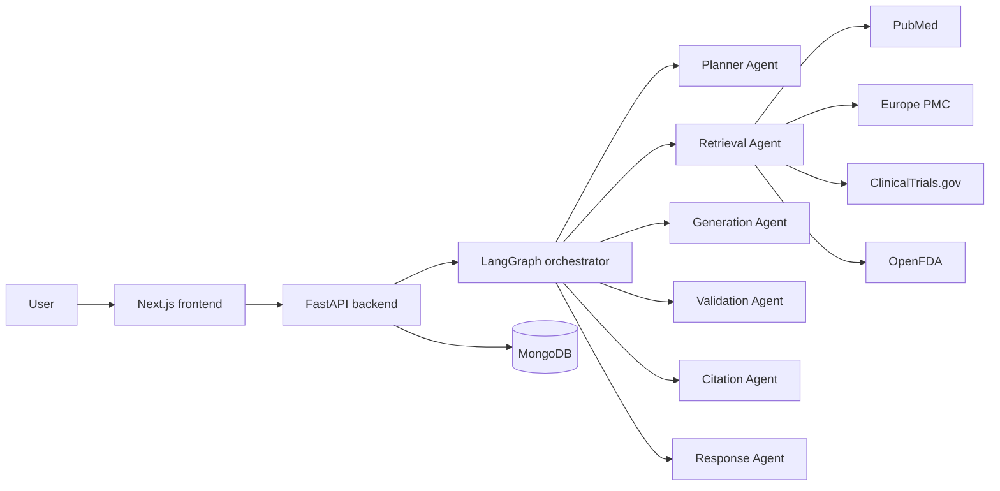
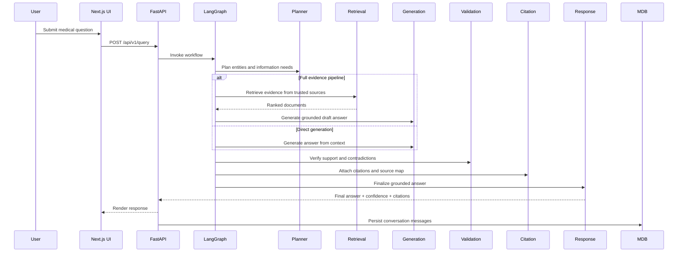

# MedInsight AI — Medical Assistant

Enterprise-grade AI system for medical information and clinical guidance. The platform combines a multi-agent LangGraph workflow, trusted-source retrieval, grounded response generation, conversation persistence, and an executive evaluation dashboard to reduce hallucinations and improve traceability.

## Problem Statement

Large language models are effective at summarization and synthesis, but they are not reliable enough for medical use without strong grounding. In medical workflows, unsupported claims, missing citations, and weak source traceability create compliance and safety risk.

This project addresses that problem by building a medical AI assistant that:

- answers from approved medical evidence across multiple trusted databases,
- enforces source traceability for every statement,
- generates confidence scores for decision support,
- abstains when evidence is insufficient,
- persists conversation history for audit and review,
- provides a clear audit trail for governance.

## Architecture

The system is split into a FastAPI backend and a Next.js frontend.



### Backend

- [FastAPI backend](backend/app/main.py) with OpenAPI docs at `/api/v1/docs`
- LangGraph workflow orchestration in [backend/app/graph/workflow.py](backend/app/graph/workflow.py)
- Multi-source retrieval via [backend/app/services/source_retriever.py](backend/app/services/source_retriever.py) and [backend/app/services/source_adapters.py](backend/app/services/source_adapters.py)
- Conversation persistence in MongoDB via [backend/app/services/conversation_service.py](backend/app/services/conversation_service.py)
- Evaluation and dashboard metrics in [backend/app/services/evaluation_service.py](backend/app/services/evaluation_service.py)
- Hallucination guardrails in [backend/app/guardrails/hallucination.py](backend/app/guardrails/hallucination.py)

### Frontend

- Next.js 15 app router in [frontend/app/](frontend/app)
- Enterprise UI shell in [frontend/components/layout/](frontend/components/layout)
- Chat workspace in [frontend/components/chat/chat-workspace.tsx](frontend/components/chat/chat-workspace.tsx)
- Trusted sources overview in [frontend/components/sources/source-viewer.tsx](frontend/components/sources/source-viewer.tsx)
- Stakeholder dashboard in [frontend/components/evaluation/evaluation-dashboard.tsx](frontend/components/evaluation/evaluation-dashboard.tsx)

## Platform Features

| Area | Capability |
|------|------------|
| **Chat** | Ask medical questions with live agent pipeline progress, markdown answers, confidence badges, and inline citations |
| **Conversation History** | Persistent sessions stored in MongoDB — create, resume, rename, and delete conversations from the sidebar |
| **Multi-Source Retrieval** | Parallel search across trusted sources with deduplication and authority-weighted ranking |
| **Agent Orchestration** | LangGraph pipeline with conditional routing, retry logic, and graceful fallbacks per agent |
| **Hallucination Control** | Evidence-only generation, claim validation, citation mapping, and abstention when support is insufficient |
| **Trusted Sources View** | Live view of configured evidence sources and their roles in the retrieval pipeline |
| **Evaluation Dashboard** | Executive metrics for hallucination rate, citation accuracy, retrieval precision, and source coverage |
| **API Layer** | REST endpoints for queries, conversations, health, config, and evaluation |

## Agent Workflow

The assistant follows a constrained multi-agent flow with conditional routing after planning.



### Agent Responsibilities

- **Planner Agent** — Interprets the question, extracts medical entities, classifies intent, and routes to retrieval, direct generation, or immediate response.
- **Retrieval Agent** — Queries approved sources in parallel, merges and deduplicates results, and returns ranked evidence candidates.
- **Generation Agent** — Produces a draft answer grounded in retrieved evidence (or conversational context) via the configured LLM.
- **Validation Agent** — Compares claims against evidence, detects contradictions, and assigns confidence scoring.
- **Citation Agent** — Maps every supported claim to one or more source citations.
- **Response Agent** — Filters unsupported content and returns the final grounded answer or abstention message.

## Trusted Evidence Sources

Retrieval uses TTL caching, parallel adapter execution, and authority-weighted ranking configured in [backend/app/core/config.py](backend/app/core/config.py).

## Hallucination Prevention

The project uses a strict guardrail model:

- LLMs may only use retrieved evidence when documents are available.
- If evidence is insufficient, the assistant returns exactly: `Insufficient evidence found.`
- Unsupported claims are removed before final output.
- Every statement must map to at least one source.
- Confidence score is mandatory on every answer.

The implementation lives in [backend/app/guardrails/hallucination.py](backend/app/guardrails/hallucination.py).

## Tech Stack

### Next.js + TypeScript + Tailwind CSS

- Fast, maintainable enterprise UI with app-router layouts and dark/light theme support.
- Streaming-friendly chat workspace with markdown rendering and responsive mobile shell.
- Polished stakeholder dashboard and UI console.

### FastAPI

- High-performance Python API framework.
- Strong request/response validation through Pydantic.
- OpenAPI documentation and structured error handling.

### LangGraph

- Explicit agent orchestration and conditional routing.
- Retry logic, fallbacks, and state transitions across the agent pipeline.

### MongoDB

- Conversation history, message metadata, and evaluation run storage.
- Async access via Motor for non-blocking API performance.

### Google Gemini (OpenAI-compatible)

- Configurable LLM provider through `LLM_API_KEY`, `LLM_BASE_URL`, and `LLM_MODEL`.
- Supports any OpenAI-compatible endpoint (OpenAI, Groq, Together, etc.).

## Evaluation Metrics (Optional)

The evaluation layer gives stakeholders operational visibility into answer quality.

### Core Metrics

- **Hallucination Rate** — Fraction of responses with unsupported or contradicted claims.
- **Citation Accuracy** — Fraction of claims mapped to correct citations.
- **Retrieval Precision** — How often retrieval surfaces relevant evidence.
- **Source Coverage** — How well the trusted source set is represented.
- **Confidence Distribution** — How responses cluster across low, medium, and high confidence.

### Metric Calculations

Metric logic is implemented in [backend/app/services/evaluation_service.py](backend/app/services/evaluation_service.py).
The dashboard UI is available at `/evaluation` and implemented in [frontend/components/evaluation/evaluation-dashboard.tsx](frontend/components/evaluation/evaluation-dashboard.tsx).


## Installation Guide

### Prerequisites

- Python 3.11+
- Node.js 20+
- MongoDB (Atlas or local)
- LLM API key (Google Gemini recommended)

### Backend Setup

```bash
cd backend
python -m venv .venv
.venv\Scripts\activate
python -m pip install -U pip
pip install -e .[dev]
```

Create a `backend/.env` file with at minimum:

```env
MONGODB_URL=
MONGODB_DB_NAME=

LLM_API_KEY=
LLM_BASE_URL=
LLM_MODEL=


### Frontend Setup

```bash
cd frontend
npm install
```

Create `frontend/.env.local`:

```env
NEXT_PUBLIC_API_URL=http://127.0.0.1:8000
```

### Run the Backend

```bash
cd backend
uvicorn app.main:app --reload
```

### Run the Frontend

```bash
cd frontend
npm run dev
```

Open `http://localhost:3000` — the app redirects to the chat workspace.

### Run Tests

```bash
cd backend
python -m pytest -q
```

Tests cover the hallucination prevention framework and evaluation service logic.


## Project Structure

```text
MedInsight-AI/
├── backend/
│   ├── app/
│   │   ├── agents/          # Planner, Retrieval, Validation, Citation, Response
│   │   ├── api/v1/          # REST route handlers
│   │   ├── core/            # Config, middleware, dependencies
│   │   ├── db/              # MongoDB client
│   │   ├── graph/           # LangGraph workflow and state
│   │   ├── guardrails/      # Hallucination prevention framework
│   │   ├── models/          # Domain models
│   │   ├── prompts/         # Agent and guardrail prompt templates
│   │   ├── schemas/         # Pydantic request/response schemas
│   │   └── services/        # Retrieval clients, LLM, conversations, evaluation
│   └── tests/
└── frontend/
    ├── app/
    │   ├── chat/            # Chat workspace
    │   ├── sources/         # Trusted sources overview
    │   ├── evaluation/      # Stakeholder metrics dashboard
    │   └── articles/        # Article detail routes
    ├── components/
    │   ├── chat/            # Chat UI, pipeline progress, source badges
    │   ├── evaluation/      # Dashboard charts and metrics
    │   ├── layout/          # App shell, sidebar, topbar
    │   └── ui/              # Shared UI primitives
    └── lib/                 # API client and shared types
```

## Documentation Notes

- The backend retrieval architecture is modular — each evidence source is a pluggable adapter.
- The frontend is optimized for clear, accessible medical information, not consumer chat UX.
- The system intentionally abstains when evidence is weak rather than producing speculative content.
- Off-topic queries are redirected by the Planner Agent to keep the assistant focused on medical topics.
